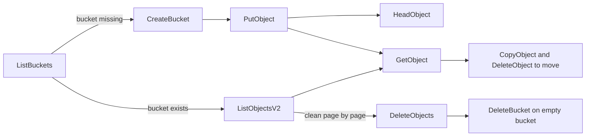

# cloud-ru-ai-agents-skills

[](#object-methods)
[](SKILL.md)
[](https://cloud.ru/docs/s3e/ug/topics/api__methods-object)
[](LICENSE)

An **AI-agent skill + markdown documentation** for [Cloud.ru Object Storage](https://cloud.ru/docs/s3e/ug/topics/api__methods-object) — S3-compatible storage with the endpoint `s3.cloud.ru`.

The repo is written primarily for **AI agents**: a root [`SKILL.md`](SKILL.md) with decision tree and pitfalls, one dense markdown file per API method with real request/response examples, and an `llms.txt` machine index.

## Install as an agent skill

The repository root is a valid skill directory — install it by cloning (or symlinking) into your agent's skills folder:

```bash
# opencode / claude / any SKILL.md-based agent
git clone https://github.com/galichandrey/cloud-ru-ai-agents-skills.git ~/.opencode/skills/cloud-ru-ai-agents-skills
# claude code users: use ~/.claude/skills/ instead
# symlink alternative (stays up to date with pulls):
ln -s /path/to/cloud-ru-ai-agents-skills ~/.opencode/skills/cloud-ru-ai-agents-skills
```

## Endpoint & authentication

```text
Endpoint:  s3.cloud.ru        (HTTP/2)
Auth:      Authorization header — S3-style signing (authorization string)
Headers:   https://cloud.ru/docs/s3e/ug/topics/api__headers-request
Errors:    https://cloud.ru/docs/s3e/ug/topics/api__response-codes
Roles:     https://cloud.ru/docs/s3e/ug/topics/security__role
```

Access to each method depends on the user's role.

## Method index

### Buckets

| Method | HTTP | Path | Purpose | Reference |
|--------|------|------|---------|-----------|
| ListBuckets | `GET` | `/` | Lists the buckets created by the caller | [list-buckets.md](methods/list-buckets.md) |
| CreateBucket | `PUT` | `/{bucket}` | Creates a bucket (empty body) | [create-bucket.md](methods/create-bucket.md) |
| DeleteBucket | `DELETE` | `/{bucket}` | Deletes a bucket — empty it first! | [delete-bucket.md](methods/delete-bucket.md) |

### Objects

| Method | HTTP | Path | Purpose | Reference |
|--------|------|------|---------|-----------|
| PutObject | `PUT` | `/{bucket}/{key}` | Adds (uploads) an object | [put-object.md](methods/put-object.md) |
| GetObject | `GET` | `/{bucket}/{key}` | Retrieves an object (latest version unless `?versionId`) | [get-object.md](methods/get-object.md) |
| HeadObject | `HEAD` | `/{bucket}/{key}` | Object metadata without downloading the body | [head-object.md](methods/head-object.md) |
| CopyObject | `PUT` | `/{bucket}/{key}` + `x-amz-copy-source` | Server-side copy of an object | [copy-object.md](methods/copy-object.md) |
| DeleteObject | `DELETE` | `/{bucket}/{key}` | Deletes an object | [delete-object.md](methods/delete-object.md) |
| DeleteObjects | `DELETE` | `/{bucket}` | Deletes objects in one call (batch) | [delete-objects.md](methods/delete-objects.md) |
| ListObjects | `GET` | `/{bucket}` | Lists up to 1000 objects (legacy version) | [list-objects.md](methods/list-objects.md) |
| ListObjectsV2 | `GET` | `/{bucket}?list-type=2` | Lists up to 1000 objects (recommended) | [list-objects-v2.md](methods/list-objects-v2.md) |

## Lifecycle



Typical agent flows:

1. **Discover:** ListBuckets → ListObjectsV2 → read each object via GetObject.
2. **Publish:** CreateBucket (if absent) → PutObject → verify with HeadObject → copy with CopyObject.
3. **Clean up / teardown:** ListObjectsV2 (paged) → DeleteObjects per page → DeleteBucket only on an empty bucket.

## Reading this as an agent

- Start with [`SKILL.md`](SKILL.md) — it contains the decision tree, method catalogue, and pitfalls in a compact form.
- **Pagination:** list responses hold at most 1000 keys and report `IsTruncated`; continue with `key-marker`.
- **Versions:** `?versionId=` selects a specific version on Get, Head and DeleteObject.
- **Idempotent delete:** DeleteObject returns `204` even for a missing key — check with HeadObject if it matters.
- **Integrity:** compare `ETag` values returned by Put/Copy with a later Head to detect changes.

## Roadmap

- [x] Object methods (Put/Get/Head/Copy/Delete/DeleteObjects/List/ListV2)
- [x] Basic bucket lifecycle (Create, List, Delete)
- [ ] Remaining bucket methods (HeadBucket, GetBucketLocation, CORS, policy, ...)
- [ ] Multipart upload (UploadPart, UploadPartCopy, CompleteMultipartUpload, ...)
- [ ] Object Lock methods
- [ ] ACL / roles in depth

## Source

All content is converted from the official cloud.ru documentation:
[Object Storage — Cloud.ru](https://cloud.ru/docs/s3e/ug/topics/api__methods-object).

## License

MIT — see [LICENSE](LICENSE).
