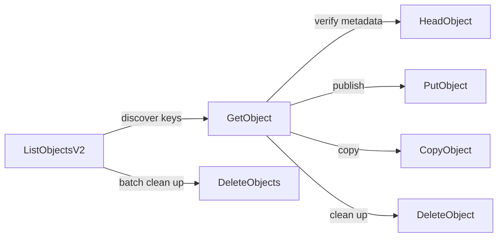

# Cloud.ru Object Storage — Object Methods

[](#object-methods)
[](https://cloud.ru/docs/s3e/ug/topics/api__methods-object)
[](#reading-this-as-an-agent)
[](#roadmap)
[](LICENSE)

Machine-friendly English reference for the **Object methods** of [Cloud.ru Object Storage](https://cloud.ru/docs/s3e/ug/topics/api__methods-object) — a S3-compatible object storage with the endpoint `s3.cloud.ru`.

This documentation is written primarily for **AI agents**: dense markdown, one file per method, deterministic links, real request/response examples.

---

## Endpoint & authentication

```text
Endpoint:  s3.cloud.ru        (HTTP/2)
Auth:      Authorization header — S3 signature (authorization string)
Headers:   https://cloud.ru/docs/s3e/ug/topics/api__headers-request
Errors:    https://cloud.ru/docs/s3e/ug/topics/api__response-codes
Roles:     https://cloud.ru/docs/s3e/ug/topics/security__role
```

Every path below is used relative to this endpoint. Access to each method depends on the user's role.

## Object methods

| Method | HTTP | Path | Purpose | Reference |
|--------|------|------|---------|-----------|
| [PutObject](methods/put-object.md) | `PUT` | `/{bucket}/{key}` | Adds (uploads) an object to a bucket |
| [GetObject](methods/get-object.md) | `GET` | `/{bucket}/{key}` | Retrieves an object (latest version unless `?versionId`) |
| [HeadObject](methods/head-object.md) | `HEAD` | `/{bucket}/{key}` | Returns object metadata without downloading the body |
| [CopyObject](methods/copy-object.md) | `PUT` | `/{bucket}/{key}` + `x-amz-copy-source` | Creates a server-side copy of an object |
| [DeleteObject](methods/delete-object.md) | `DELETE` | `/{bucket}/{key}` | Deletes an object |
| [DeleteObjects](methods/delete-objects.md) | `DELETE` | `/{bucket}` | Deletes objects in one call (batch) |
| [ListObjects](methods/list-objects.md) | `GET` | `/{bucket}` | Lists up to 1000 objects (legacy version) |
| [ListObjectsV2](methods/list-objects-v2.md) | `GET` | `/{bucket}?list-type=2` | Lists up to 1000 objects (recommended version) |

## Object lifecycle



Typical agent flows:

1. **Discover:** ListObjectsV2 → read each object via GetObject.
2. **Publish:** PutObject → verify with HeadObject → copy with CopyObject.
3. **Clean up:** ListObjectsV2 (with `prefix`/`max-keys`) → DeleteObjects batch or per-key DeleteObject.

## Reading this as an agent

- **Pagination:** list responses hold at most 1000 keys and report `IsTruncated`; continue with `key-marker`. In V2, `KeyCount` is the per-page count.
- **Versions:** `?versionId=` selects a specific version on Get, Head and DeleteObject; versioning-dependent buckets set it in method responses (`x-amz-version-id`).
- **ListObjectsV2 guard:** without `list-type=2` the legacy ListObjects is invoked silently — always send it.
- **Idempotent delete:** DeleteObject returns `204` even for a missing key — verify existence first if it matters ([HeadObject](methods/head-object.md)).
- **Integrity:** compare `ETag` values returned by Put/Copy with a later Head to detect changes.

## Roadmap

We will expand this documentation repo step by step:

- [ ] Bucket methods (CreateBucket, ListBuckets, ...)
- [ ] Multipart upload (UploadPart, UploadPartCopy, CompleteMultipartUpload, ...)
- [ ] Object Lock methods
- [ ] ACL / policies / role model details

## Source

All content is converted from the official cloud.ru documentation:
[Методы Object — Object Storage / Cloud.ru](https://cloud.ru/docs/s3e/ug/topics/api__methods-object).

## License

MIT — see [LICENSE](LICENSE).
